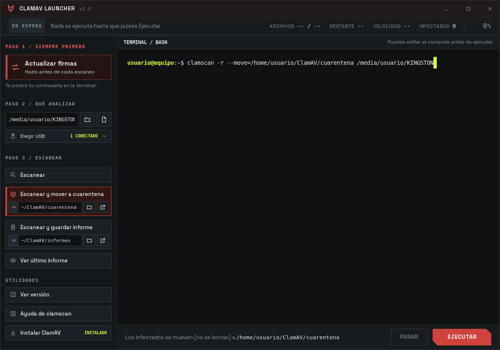

# ClamAV Launcher

Revisa tus USB y archivos en busca de virus con [ClamAV](https://www.clamav.net/), sin necesidad de saber usar la terminal. Para Linux.

**Versión 1.0**. La versión instalada aparece junto al título de la ventana.



La ventana tiene una terminal y unos botones. Cada botón **escribe** un comando en la terminal, pero no lo lanza: tú lo ves y pulsas **Ejecutar** cuando quieras. Así nunca pasa nada sin que lo decidas y, de paso, aprendes qué hace cada comando.

## Instalación

1. **Descarga el proyecto**: en GitHub, botón verde **Code → Download ZIP**, y descomprímelo.
2. **Abre una terminal en esa carpeta**: haz clic derecho dentro de la carpeta y elige **«Abrir en una terminal»** (el nombre puede variar un poco).
3. **Escribe esto y pulsa Enter**:

   ```bash
   bash install.sh
   ```

   Si a tu sistema le falta algo (por ejemplo, el propio ClamAV), el instalador te dirá qué va a instalar y te pedirá permiso y tu contraseña.

Al terminar, busca **ClamAV Launcher** en tu lanzador de aplicaciones y ábrela como cualquier otra app. La carpeta descargada ya no hace falta: puedes borrarla.

### Sin instalar (portable)

Si prefieres no instalarla, abre una terminal en la carpeta descargada y escribe:

```bash
python3 clamav_launcher.py
```

La app se abre sin añadir nada al lanzador. Eso sí, tu sistema tiene que tener ya los componentes que necesita (GTK, VTE y ClamAV). Si falta alguno, la app te dirá cuál y cómo instalarlo.

## Uso

1. **Actualizar firmas**: descarga la lista de virus más reciente. Hazlo antes de cada revisión.
2. **Qué analizar**: elige una carpeta, un archivo o un USB conectado.
3. **Escanear**: elige cómo.
   - **Escanear**: solo revisa.
   - **Escanear y mover a cuarentena**: aparta los archivos infectados a otra carpeta. No los borra.
   - **Escanear y guardar informe**: guarda el resultado en un archivo con la fecha y la hora.
4. Pulsa **Ejecutar**. Arriba verás el avance, el tiempo restante y cuántos archivos infectados hay. **Parar** detiene el análisis.

Si pasas el ratón por encima de un botón, verás qué comando escribe y para qué sirve.

## Preguntas frecuentes

**¿Por qué tarda en empezar?** ClamAV carga primero su lista de virus: unos 20-30 segundos y alrededor de 1 GB de memoria. Es normal.

**¿Borra mis archivos?** No. La cuarentena solo mueve los archivos infectados a otra carpeta (por defecto, `ClamAV/cuarentena` dentro de tu carpeta personal).

**¿La app ve mi contraseña?** No. La pide el propio sistema en la terminal, solo para actualizar firmas o instalar ClamAV. La app nunca la ve ni la guarda.

**¿Cómo la actualizo?** Descarga la versión nueva y vuelve a ejecutar `bash install.sh`.

## Desinstalar

Abre una terminal (en cualquier carpeta) y escribe:

```bash
bash ~/.local/share/clamav-launcher/uninstall.sh
```

ClamAV y tus carpetas de cuarentena e informes no se tocan.

## Mantenimiento

Es un proyecto personal sin mantenimiento activo. Si encuentras un problema, puedes avisar en [Issues](https://github.com/alvaro-ruiz-lab/ClamAV-Launcher/issues), pero puede tardar en tener respuesta o no tenerla.

## Licencia

[MIT](LICENSE): puedes usarla, copiarla, modificarla y compartirla libremente, manteniendo el aviso de autoría.

---

¿Quieres saber cómo funciona por dentro? Mira los [detalles técnicos](docs/TECNICO.md).
